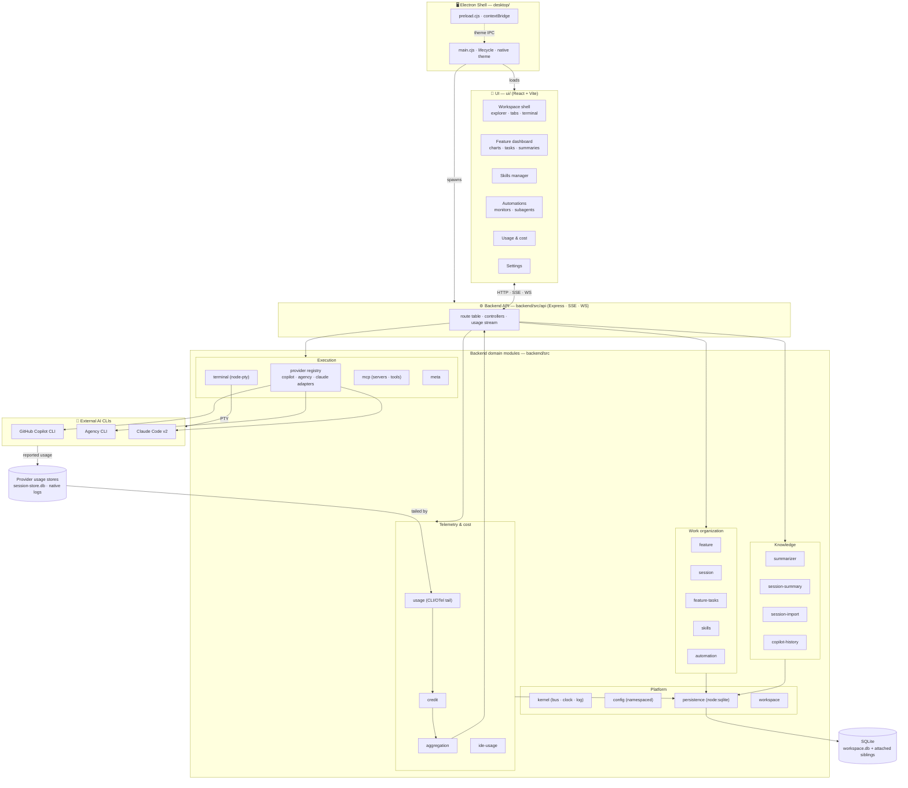

# AI Project Studio

[](https://github.com/sourabh1007/ai-project-studio/actions/workflows/ci.yml)

An **IDE-style desktop app** that turns AI coding CLIs (GitHub Copilot, optional Agency, and native Claude Code v2) into a project-centric, observable workspace. AI Project Studio organizes CLI work by **Feature → Session**, runs the interactive CLI in an embedded terminal, and surfaces **credit (AIC), token, cost, and time** analytics where providers report them. Unavailable billing is not zero; separately labelled USD estimates are not AIC.

It also layers AI-native productivity on top of the raw CLI: reusable **skills** (instruction blocks auto-seeded into sessions), AI-generated **feature task plans**, and automatic **session/feature summaries**.

Built as an npm-workspaces monorepo: a modular **Express** backend (ports & adapters), a **React + Vite** UI, and an **Electron** shell that ties them into a single desktop application.

> New here (human or AI agent)? Start with **[AGENTS.md](AGENTS.md)** and the **[docs/](docs/)** folder.

## Architecture (module-wise)



See **[docs/architecture.md](docs/architecture.md)** for the detailed data flow and **[docs/backend-modules.md](docs/backend-modules.md)** for a per-module reference.

## Features (high level)

Each feature has a focused how-to guide in **[docs/features/](docs/features/README.md)**.

- **[Feature categories](docs/features/feature-categories.md)** — organize every run as **Repository → Feature → Group → Session**.
- **[Planner](docs/features/planner.md)** — dated tasks/backlog, GitHub/ADO imports, exports, AI summaries and recoverable workspace launches.
- **[Sessions](docs/features/sessions.md)** — run the globally selected CLI in an embedded `xterm.js` terminal, choose its interactive model natively, and use launch-time context, summaries and supported history import.
- **[Skills](docs/features/skills.md)** — reusable instruction blocks tagged onto features/sessions and auto-seeded into a session's first prompt.
- **[PR reviews](docs/features/pr-reviews.md)** — Open Pull Request into a **Review Board**: summary, change graph, evidence-grounded perspectives, file diffs, comments, reviewer sign-off and provider-backed approval.
- **[New Task](docs/features/new-task.md)** — attach the **New Task agent** to a feature to solve a problem end to end: it plans the change for review, then implements it with a **team of parallel agents** (a lead agent + developer/tester sub-agents on separate metasessions), shows the live hierarchy with per-agent time/token/credit metrics and per-file diffs, and opens a pull request.
- **[Bug Bash](docs/features/bug-bash.md)** — prepare prerequisites, review/refine scenarios, run a tester team, and inspect evidence-audited findings and reproducible reports.
- **[Monitors & Automations](docs/features/automations.md)** — background monitors that run shell, HTTP, AI, or CI checks on an interval, evaluate conditions, and fire metasession, subagent, report, or command actions.
- **[MCP servers](docs/features/mcp-servers.md)** — inspect source-scoped configuration/provenance, edit supported sources and probe verified tool inventories. Ordinary edits affect subsequent launches, not generic live tool toggles or restarts.
- **[Usage & cost](docs/features/usage-and-cost.md)** — live credit (AIC), token, cost & time from the CLIs' own telemetry, feature dashboards, and **IDE AI** metasession attribution that rolls up across the whole hierarchy.

Also: nested features, repository insights and shared-context workspace panels, a pluggable three-provider registry, local-first SQLite persistence (`node:sqlite`), and light/dark themes with native window chrome. The activity bar has eight destinations: Workspace, Planner, Skills, MCP, Automations, Usage, Agents and Settings.

## How it differs from the Copilot app

The GitHub Copilot app/CLI is a single-conversation coding assistant. AI Project Studio wraps that same CLI in a project-centric, observable workspace — it doesn't replace the CLI, it organizes and instruments it. The Copilot app is the *engine*; AI Project Studio is the *cockpit*.

See **[docs/vs-copilot-app.md](docs/vs-copilot-app.md)** for the full side-by-side comparison and guidance on when to use which.

## Getting Started

### Prerequisites
- **Node.js ≥ 24.20.0** for development/building from source; CI and runtime provisioning pin **24.20.0**. Packaged desktop builds provision their own compatible backend runtime, GitHub CLI (`gh`), and portable Git on Windows; end users do **not** need system Node.
- Choose an installed CLI, or explicitly consent with **Install and use**. Copilot uses its official npm package; Agency uses its official internal InstallTool bootstrap after authorized-user opt-in; Claude uses its supported platform installer. Detection never installs a CLI or grants entitlement.
- Native Claude Code **v2** subscription sign-in supports interactive sessions. App-driven headless summaries/agents require operator-owned supported API/cloud credentials; native subscription login alone does not authorize them. Agency is hidden until explicitly enabled in Settings → CLI and still requires its own authentication.
- Automated headless work also requires safe tool isolation. **Agency automated metasessions are currently blocked** because native MCP defaults/overlays cannot be safely suppressed; interactive Agency remains available. Copilot/Claude headless runs can likewise refuse unsafe or uninspectable configuration rather than silently run with extra tools. See [provider safety](docs/adding-a-provider.md#headless-tool-isolation).
- Desktop builds pin **Electron 44.9.3**: **64-bit only**, **macOS 13 Ventura or newer** (macOS 12 is unsupported). Current installers target Windows x64 and macOS arm64/x64; no 32-bit installer is shipped. Native dependencies and installer behavior still require platform qualification; source tests do not establish native support.

### Install
```bash
git clone https://github.com/sourabh1007/ai-project-studio.git
cd ai-project-studio
npm install
```

### Run the desktop app
```bash
npm run desktop      # builds backend + UI, launches the Electron shell
```

### Development
```bash
npm run dev          # backend + UI with hot reload (browser)
npm run desktop:dev  # Electron shell pointed at the dev server
```

### Build & test
```bash
npm run build                          # build backend and UI
npm run test:coverage --workspace backend   # backend suite (100% coverage gate)
npm run test:coverage --workspace ui        # UI suite
npm run lint                           # typecheck the backend
```

## Releases

The **CI** workflow runs build, backend/UI coverage gates and the desktop harness on its configured push/PR triggers. Passing these deterministic checks does not qualify live providers, accounts, native installers or upgrades.

The **Release prerelease** workflow verifies the exact commit before packaging Windows x64, macOS arm64 and macOS x64 installers. Manual dispatch retains internal artifacts; pushing a `v*` tag additionally publishes the hash-checked installers and provenance as an explicitly **unqualified GitHub prerelease**, never an automatic stable promotion:

```bash
git tag v0.8.0
git push origin v0.8.0
```

Produces candidates (and, for a successful tag push, prerelease downloads):
- **Windows** — `.exe` (NSIS installer), signed with [Azure Trusted Signing](https://learn.microsoft.com/azure/trusted-signing/) when all required signing settings are configured.
- **macOS** — architecture-specific `.dmg`, ad-hoc signed by default or Developer ID signed/notarized when all Apple settings are supplied. Partial Apple/Windows signing settings fail closed. Ad-hoc/unqualified candidates are not eligible for production promotion.

Production promotion requires native runtime, installer/upgrade/restore, and signature qualification for every shipped platform, tied to the exact artifact hashes in `candidate-<platform>-<arch>.json`. Promote those qualified bytes without rebuilding. A passing source gate or a stable-looking version tag alone is not release approval; see the [channel policy](docs/development.md#code-signing).

**Windows signing:** if all settings are absent, an explicitly unsigned internal candidate is permitted. Partial signing configuration fails instead of silently falling back to unsigned output.

**macOS internal testing only:** unsigned candidates may be blocked by Gatekeeper. Bypassing that warning is not production qualification. If you have independently established that an internal artifact is trustworthy, first-launch options include:
> - **Right-click** the app in Finder → **Open** → **Open** (only needed the first time), or
> - clear the quarantine flag: `xattr -dr com.apple.quarantine "/Applications/AI Project Studio.app"`.

### Automatic updates

The app's **custom** `desktop/update-manager.cjs` checks GitHub Releases; it does not use `electron-updater` or promise differential/blockmap updates. Unqualified prereleases are not stable update approval:

- It checks for updates on launch and periodically in the background, then **notifies you inside the app** — a top banner and a **Settings ▸ About ▸ Software updates** panel show the current version, the available version, and release notes.
- **Windows:** an offered in-app install must pass qualified release/version/platform/architecture, SHA-256 and OS-valid Authenticode checks against a locally pinned signer fingerprint or exact full subject. Missing trust pins, unqualified metadata or mismatches fail closed. Save work before **Restart & install**.
- **macOS:** guided download/install remains the supported update flow. Signing alone does not enable automatic ZIP/Squirrel installation.
- Update failures are always non-fatal — the app stays responsive and simply keeps running the current version.

See [docs/development.md → Auto-update](docs/development.md#auto-update) for the architecture and release requirements.

## Project Structure

| Path | Description |
| --- | --- |
| `backend/` | Express API + domain modules (TypeScript, ports & adapters) |
| `ui/` | React + Vite front-end |
| `desktop/` | Electron shell (spawns the backend, loads the UI) |
| `docs/` | Architecture, module reference, and contributor/agent guides |
| `AGENTS.md` | Entry point and working agreement for AI agents & new contributors |

## Documentation

**Using the app**

| Doc | What's inside |
| --- | --- |
| [docs/features/](docs/features/README.md) | **Feature guides** — task-focused how-tos with in-app navigation. |
| ↳ [Feature categories](docs/features/feature-categories.md) | Repository → Feature → Group → Session. |
| ↳ [Planner](docs/features/planner.md) | Daily work/backlog, imports, summaries, exports and launch recovery. |
| ↳ [Sessions](docs/features/sessions.md) | Running the AI CLI, summaries, importing history. |
| ↳ [Skills](docs/features/skills.md) | Reusable instructions auto-seeded into prompts. |
| ↳ [PR reviews](docs/features/pr-reviews.md) | Review Board summary, change graph, perspectives, comments and approval. |
| ↳ [New Task](docs/features/new-task.md) | Plan a change, implement it with a parallel agent team, open a PR. |
| ↳ [Bug Bash](docs/features/bug-bash.md) | Prepare, refine scenarios, run testers and audit evidence. |
| ↳ [Monitors & Automations](docs/features/automations.md) | Background monitors, actions, tracked subagents, and automation controls. |
| ↳ [MCP servers](docs/features/mcp-servers.md) | Inspect source-scoped configuration and supported tool inventories. |
| ↳ [Usage & cost](docs/features/usage-and-cost.md) | Credits, tokens, dashboards, IDE AI. |
| [docs/vs-copilot-app.md](docs/vs-copilot-app.md) | How AI Project Studio differs from the Copilot app. |

**Building & contributing**

| Doc | What's inside |
| --- | --- |
| [AGENTS.md](AGENTS.md) | How to work in this repo: conventions, invariants, workflow |
| [docs/architecture.md](docs/architecture.md) | Application architecture design: layers, data flow, key patterns |
| [docs/metasessions.md](docs/metasessions.md) | Headless AI turns: the MetaRunner chain, warm pool, internal scope, Saved AI operations |
| [docs/agents.md](docs/agents.md) | The agent platform: Review Board, New Task, Bug Bash and how to add one |
| [docs/backend-modules.md](docs/backend-modules.md) | Per-module responsibilities & key files |
| [docs/ui-guide.md](docs/ui-guide.md) | UI structure, feature areas, and what's actually mounted |
| [docs/development.md](docs/development.md) | Setup, scripts, testing, debugging, env quirks |
| [docs/integration-qualification.md](docs/integration-qualification.md) | User-facing capability matrix, integration suites, and environment qualification boundaries |
| [docs/adding-a-provider.md](docs/adding-a-provider.md) | Add a new CLI tool behind the provider interface |

## License

Private project.
